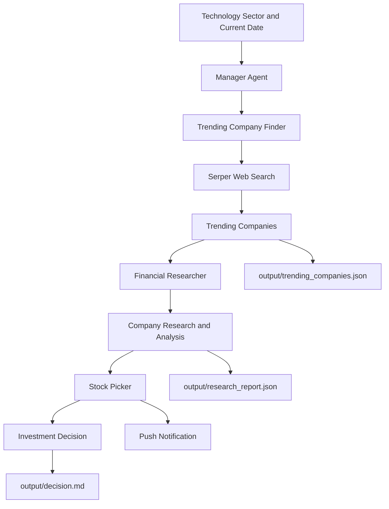

# Stock Picker — Multi-Agent AI Investment Research System

A multi-agent financial research and stock selection application built with **CrewAI**. It identifies trending technology companies using web search, researches their financial performance and investment potential, compares the findings, and selects a company based on the generated analysis.

The application uses specialized AI agents to discover trending companies, conduct financial research, and produce a final investment decision with supporting reasoning. It can also send a push notification containing the selected company and a brief rationale.

The current implementation focuses on the **Technology sector** and uses AI models accessed through the MixRoute API.

## How It Works

The crew uses three specialized agents coordinated by a manager through CrewAI's hierarchical process.

1. **Trending Company Finder:** Searches the web for recent news and identifies 2–3 trending companies in the selected sector, including their names, stock ticker symbols, and reasons for attracting attention.
2. **Financial Researcher:** Researches the identified companies and evaluates their market positions, competitive advantages, future outlooks, and investment potential.
3. **Stock Picker:** Analyzes the research findings, selects the company considered the strongest investment candidate, explains why the other companies were not selected, and sends a push notification with the decision.

A manager agent coordinates the workflow and delegates tasks to the appropriate agents. The research task's output is passed to the final selection task as context, allowing the stock picker to build on the collected findings.



## Tech Stack

- **Python:** `>=3.10,<3.14`
- **CrewAI:** `1.14.4`
- **uv:** Dependency and environment management
- **MixRoute:** LLM API access
- **Gemini:** `gemini-3.5-flash-lite` for the manager agent
- **DeepSeek:** `deepseek-v4-flash` for the research and stock selection agents
- **SerperDevTool:** Web search for identifying trending companies and gathering financial information
- **Pydantic:** Structured output models for company research
- **PyYAML:** Agent and task configuration
- **Pushover:** Push notifications for investment decisions
- **Markdown and JSON:** Generated reports and intermediate research outputs

## Agents and Models

| Agent | Responsibility | Model | Tools |
|---|---|---|---|
| Manager | Coordinates the workflow and delegates tasks | `gemini-3.5-flash-lite` | Agent delegation |
| Trending Company Finder | Identifies trending companies in the selected sector | `deepseek-v4-flash` | Serper web search |
| Financial Researcher | Researches company performance, market position, and investment potential | `deepseek-v4-flash` | Serper web search |
| Stock Picker | Selects the preferred investment candidate and explains the decision | `deepseek-v4-flash` | Push notification tool |

Both models are configured through the MixRoute API endpoint in `src/stock_picker/crew.py`.

The workflow uses `Process.hierarchical`, with the manager agent coordinating the tasks. The company research task receives the trending-company discovery results as context, and the final selection task receives the financial research results as context.

## Getting Started

### Prerequisites

Install the following before running the project:

- Python 3.10–3.13
- [uv](https://docs.astral.sh/uv/)
- A MixRoute API key for LLM access
- A Serper API key for web search
- An OpenRouter API key for the configured embedding provider
- Pushover user key and application API token for push notifications

### 1. Clone the Repository

```bash
git clone <your-repository-url>
cd crewai-stock-picker-main
```

Replace `<your-repository-url>` with your actual GitHub repository URL and adjust the directory name if necessary.

### 2. Install Dependencies

Install `uv` if it is not already installed:

```bash
pip install uv
```

From the project root, install the dependencies defined in `pyproject.toml`:

```bash
uv sync
```

This installs the project's Python dependencies into the managed environment.

### 3. Configure Environment Variables

Create a `.env` file in the project root with the following variables:

```ini
MIXROUTE_API_KEY=your_mixroute_api_key
OPENROUTER_API_KEY=your_openrouter_api_key
SERPER_API_KEY=your_serper_api_key
PUSHOVER_USER=your_pushover_user_key
PUSHOVER_TOKEN=your_pushover_application_token
```

**What each variable is used for:**

- `MIXROUTE_API_KEY`: Authenticates requests to the MixRoute LLM endpoint.
- `OPENROUTER_API_KEY`: Authenticates requests to the OpenRouter embedding provider configured in the crew.
- `SERPER_API_KEY`: Enables web searches through `SerperDevTool`.
- `PUSHOVER_USER`: Identifies the Pushover recipient.
- `PUSHOVER_TOKEN`: Authenticates the Pushover application.

You can obtain API credentials from the relevant providers:

- MixRoute: https://mixroute.ai/
- Serper: https://serper.dev/
- OpenRouter: https://openrouter.ai/
- Pushover: https://pushover.net/

Replace the placeholders with your actual credentials. Keep your `.env` file private and ensure it is excluded from Git commits.

### 4. Run the Project

Execute the application from the project root:

```bash
uv run run_crew
```

Alternatively, use the CrewAI CLI:

```bash
uv run crewai run
```

The application starts from `src/stock_picker/main.py`, initializes the `StockPicker` crew, executes the workflow, and prints the final result to the terminal.

The configured tasks also save their outputs to the `output/` directory.

## Choose a Sector to Research

The sector and current date are currently defined in `src/stock_picker/main.py`:

```python
inputs = {
    "sector": "Technology",
    "current_date": datetime.now().strftime("%Y-%m-%d")
}
```

To research another sector, change the `sector` value:

```python
inputs = {
    "sector": "Healthcare",
    "current_date": datetime.now().strftime("%Y-%m-%d")
}
```

Other possible sectors include:

- Technology
- Healthcare
- Renewable Energy
- Banking and Financial Services
- Electric Vehicles
- Semiconductors

The selected sector influences the company discovery task. The research and selection process then evaluates the companies returned by the discovery agent.

The project currently uses a hard-coded sector rather than accepting interactive user input or command-line arguments.

## Report Generation

The application generates three primary outputs.

### 1. Trending Companies

File:

```text
output/trending_companies.json
```

Contains the companies identified by the discovery agent.

The expected structure is:

```json
{
  "companies": [
    {
      "name": "Example Company",
      "ticket": "EXMP",
      "reason": "The company is attracting attention because of recent developments."
    }
  ]
}
```

The example above illustrates the expected schema; the actual companies and findings depend on the web search results.

### 2. Financial Research Report

File:

```text
output/research_report.json
```

Contains the research findings for the discovered companies.

The expected research fields include:

- Company name
- Current market position and competitive analysis
- Future outlook and growth prospects
- Investment potential and suitability for investment

This report provides the information used by the stock picker to compare candidates.

### 3. Final Investment Decision

File:

```text
output/decision.md
```

Contains the final investment decision and detailed analysis.

The final task is configured to explain:

- Which company was selected
- Why the selected company was preferred
- Relevant financial and market considerations
- The companies that were not selected
- The reasons those alternatives ranked lower
- The final decision and its supporting rationale

The selection reflects the AI agents' analysis of the information available during execution. It should not be interpreted as a guaranteed prediction of future stock performance.
